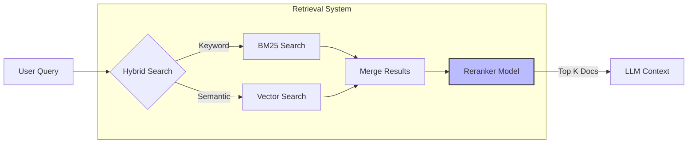

# AI Agent 개발을 위한 Production Question 가이드 (강의용 확장판)
> “에이전트를 어떻게 만드는가”가 아니라  
> “왜 대부분의 에이전트가 운영에서 실패하는가”를 설명하기 위한 실전 가이드  
>  
> 대상: AI Agent를 실제 서비스로 운영하려는 소프트웨어 엔지니어

---

## 1. 목적(Purpose) & 사용 방식(How to Use)

### 핵심 질문  
**에이전트가 잘못된 결과를 냈을 때, 누가 책임을 지며 시스템은 어떻게 회복되는가?**

### 강의 설명  
대부분의 AI Agent 튜토리얼은 “에이전트가 무엇을 할 수 있는지”에 집중합니다.  
하지만 실제 운영 환경에서 더 중요한 질문은 다음입니다.

> “이 결과가 틀렸을 때, 우리는 무엇을 할 수 있는가?”

LLM은 deterministic system이 아닙니다.  
따라서 **오답은 버그가 아니라 정상 동작 범위**에 속합니다.  
문제는 오답 그 자체가 아니라,  
- 오답을 누가 책임지는지
- 오답 이후 시스템이 어떻게 행동하는지
가 설계되어 있지 않다는 점입니다.

### 실무 사례  
- 계약서 요약 에이전트가 중요한 면책 조항을 누락
- 사용자는 이를 사실로 받아들이고 내부 보고에 사용
- 이후 법무 검토 단계에서 오류 발견

이때 흔히 발생하는 혼란:
- “AI가 그렇게 말했어요”
- “사용자가 확인 안 한 게 문제 아닌가요?”
- “이건 PoC라서…”

→ **책임 경계가 정의되지 않은 시스템은 반드시 분쟁을 만든다**

### 설계 관점에서 던져야 할 질문
- 이 에이전트의 결과는 **의사결정 보조인가, 결정 자체인가?**
- 어떤 결과는 반드시 사람의 확인을 거쳐야 하는가?
- 사용자가 에이전트의 한계를 명확히 인지하도록 UX가 설계되어 있는가?

### 핵심 교훈
- **에이전트의 “사용 가이드”는 설명서가 아니라 책임 계약서다.**
  > *"LLM 개발은 기존 기능 중심 애자일만으로는 한계가 존재... 결과 품질을 예측하기 어려움"*
  >
  > 위 인용처럼 결과 품질이 예측하기 어렵다면, “틀릴 수 있다”는 사실 자체가 시스템의 정상 범위가 됩니다.  
  > 따라서 사용자는 결과를 어디까지 신뢰하고(의사결정 보조 vs 결정 자체), 어떤 경우에 사람이 확인해야 하는지(책임 경계)를 **사용 가이드에 명시**해야 합니다.  
  > 이 의미에서 사용 가이드는 기능 설명서가 아니라 **책임 경계(책임 계약)**를 정의하는 문서가 됩니다.

- **기능 구현보다 품질 기준 합의가 먼저다.**
  > *"고객은 100% 의 품질을 원함... 사용자가 결과에 대해 납득할 수 있는 UX가 필요"*
  >
  > 기능 개발(Feature)보다 "어느 수준까지 책임질 것인가"에 대한 합의가 선행되어야 합니다.

---

## 2. LLM 모델 선택 기준

### 핵심 질문  
**이 모델이 느려지거나, 장애가 나거나, Quota에 걸리면 시스템은 어떻게 동작하는가?**

### 강의 설명  
LLM을 라이브러리처럼 생각하는 순간, 운영은 실패합니다.  
LLM은 다음과 같은 특성을 가진 **외부 시스템 의존성**입니다.

- 네트워크를 탄다
- 지역별 성능 편차가 있다
- 예고 없이 느려진다
- 요금과 쿼터가 있다

그럼에도 많은 설계가 다음 가정 위에 서 있습니다.

> “이 모델은 항상 빠르고, 항상 응답한다”

이 가정은 반드시 깨집니다.

### 실무 사례  
- 특정 리전에서 LLM 응답이 평소보다 5~10배 느려짐
- 프론트엔드는 스트리밍이 멈춘 것처럼 보임
- 사용자는 새로고침 → 동일 요청 재전송
- 백엔드에서는 동일 작업이 중복 실행 → 비용 폭증

### 설계 관점에서 던져야 할 질문
- 이 작업은 반드시 이 모델이어야 하는가?
- 응답이 늦어질 경우 UX는 어떻게 반응해야 하는가?
- 모델 장애 시 기능을 축소해서라도 제공할 수 있는가?

### 핵심 교훈
- **모델 선택은 AI 성능 문제가 아니라 아키텍처 문제다.**
  > *"LLM 호출시 응답지연이 발생하는가?... 특정 리전에서 특정 시점에서 요청이 몰리는 경우 해당 지역만 느려지는 현상이 발생"*
  >
  > 위처럼 리전/시점에 따라 성능이 급변한다면, 모델은 “항상 일정한 함수 호출”이 아니라 “언제든 느려지거나 멈출 수 있는 외부 의존성”입니다.  
  > 그래서 모델 선택은 단순 정확도 비교가 아니라, **지연/장애/재시도/중복실행/UX**까지 포함한 아키텍처 설계로 다뤄야 합니다.

- **“최고 성능 모델 하나”보다 “상황별 모델 조합”이 훨씬 안정적이다.**
  > *"동일 모델에 대해서 제한이 있으므로 모델을 다양화하여 사용하는 것으로 해결할 수도 있음"*
  >
  > 동일 모델에 제한(Quota)이 있다면, 단일 모델은 곧 단일 장애점(SPOF)이 됩니다.  
  > 따라서 상황별로 모델을 분산(또는 이중화)해 **“제한/지연/장애”가 곧 “전체 서비스 중단”으로 번지지 않게** 만드는 편이 더 안정적입니다.

---

## 3. Planning & Orchestration (Workflow)

### 핵심 질문  
**이 워크플로우는 언제, 어떤 기준으로, 어떻게 중단될 수 있는가?**

### 강의 설명  
Agent 기반 시스템은 시간이 지날수록 다음과 같이 변합니다.

- 노드가 늘어난다
- 그래프가 중첩된다
- 한 번 추가된 단계는 거의 제거되지 않는다

결과적으로 “끝까지 실행하는 것이 미덕”처럼 설계되기 쉽습니다.  
하지만 운영 관점에서 중요한 것은 **완주 여부가 아니라 가치 여부**입니다.

### 실무 사례  
- RAG → 분석 → 요약 → 재질문 → 재분석
- 중간 단계에서 이미 검색 결과가 부정확
- 그럼에도 전체 파이프라인 끝까지 실행
- 결과는 별로인데, 비용은 최댓값

### 설계 관점에서 던져야 할 질문
- 지금 이 단계가 실패했다면, 다음 단계가 의미가 있는가?
- UI 중단과 연산 중단은 구분되어 있는가?
- 비용이 큰 노드는 언제 탈출할 수 있는가?

### 핵심 교훈
- **성공 경로보다 실패 경로가 명확한 그래프가 더 성숙한 설계다.**
  > *"연결이 끊겨도 실행이 되어야 하는가? ... 연결이 끊길 때 실행이 종료되어야 하면 service단에서 처리"*
  >
  > 위 인용은 “연결이 끊겼을 때도 계속 실행할지/종료할지”를 **사전에 선택**해야 한다는 뜻입니다.  
  > 즉, 운영에서 중요한 건 “항상 끝까지 실행”이 아니라, 실패/중단/재개를 포함한 **실패 경로를 정상 플로우로 설계**하는 것입니다.

- **Debugging 가능한 Orchestration이 운영 비용을 줄인다.**
  > *"Supervisor 패턴이 debugging, tracing에 용이하며 Swarm은 매우 난이도 높음"*
  >
  > 디버깅/트레이싱이 쉬운 패턴이 운영에 유리하다는 건, 문제가 났을 때 “원인 규명 시간”이 비용을 결정한다는 의미입니다.  
  > 그래서 Swarm처럼 추적 난이도가 높은 구조보다, Supervisor처럼 **흐름이 관측 가능한 오케스트레이션**을 우선 선택하는 것이 운영 비용을 줄입니다.

---

## 4. Action & Tool

### 핵심 질문  
**이 작업을 LLM에게 맡김으로써 시스템은 단순해졌는가, 아니면 불투명해졌는가?**

### 강의 설명  
Tool은 LLM의 능력을 확장하지만, 동시에 **책임과 추론을 이전**합니다.  
특히 다음과 같은 경우 문제가 됩니다.

- 결정적이어야 할 로직
- 재현성이 필요한 작업
- 사후 분석이 필요한 판단

### 실무 사례  
- Git 브랜치명 생성, 커밋 메시지 작성, 배포 판단까지 LLM에 위임
- 결과는 매번 다르고, 기준을 설명할 수 없음
- 장애 발생 시 “왜 그렇게 판단했는지” 추적 불가

### 설계 관점에서 던져야 할 질문
- 이 판단은 확률적이어도 괜찮은가?
- 코드로 표현 가능한 규칙은 없는가?
- LLM이 선택해야 할 옵션 수는 최소화되어 있는가?

### 핵심 교훈
- **Tool은 기능이 아니라 책임 단위로 설계해야 한다.**
  > *"Git operation 조차 LLM이 굳이 해야하는가? ... 커밋 메세지도 고민해야하는가?"*
  >
  > 위 인용은 “LLM이 굳이 고민할 필요 없는 결정(브랜치명/커밋 메시지 등)”까지 위임하면, 책임 경계가 흐려지고 결과가 재현/설명되기 어려워진다는 문제의식입니다.  
  > 그래서 Tool은 단순 기능 묶음이 아니라, **LLM이 판단해도 되는 범위(책임 단위)**로 설계되어야 합니다.

- **LLM이 잘할 것이라는 기대는 설계가 아니다.**
  > *"Sonnet만 사용하더라도 10개 이상의 tool을 사용하게 되면... 성능/비용에 영향"*
  >
  > Tool 수가 많아질수록 모델은 “어떤 도구를 쓸지”를 고르는 비용이 커지고(토큰/추론/실패 가능성), 그 자체가 성능·비용에 영향을 준다는 뜻입니다.  
  > 따라서 “모델이 알아서 잘 고르겠지”가 아니라, **도구를 최소화하고 선택지를 강제**하는 쪽이 더 예측 가능하고 경제적입니다.

---

## 5. Memory

### 핵심 질문  
**이 시스템은 중단 후 재개했을 때, 같은 맥락을 유지할 수 있는가?**

### 강의 설명  
메모리는 흔히 “지능을 높이는 기능”으로 소개됩니다.  
하지만 운영 관점에서 메모리는 **복구 메커니즘**입니다.

### 실무 사례  
- 장시간 분석 중 네트워크 끊김
- 사용자가 다시 접속
- 에이전트는 일부만 기억 → 이전 판단 근거 상실
- 결과적으로 앞뒤가 맞지 않는 답변 생성

### 설계 관점에서 던져야 할 질문
- 언제 상태를 저장하는가?
- 어떤 상태는 저장하지 않아도 되는가?
- 요약은 어떤 기준으로 수행되는가?

### 핵심 교훈
- **기억한다 ≠ 복원할 수 있다.**
  > *"중간에 끊겨도 복구해야 하거나 감사 등을 위해 장기 보존해야 하는지? ... 엔터프라이즈 환경이면 최소 DB Persistence 백업 필수"*
  >
  > 위 인용은 “중간에 끊겨도 복구/감사/장기보존” 요구가 있으면 **영구 저장(persistence)**이 필수라는 뜻입니다.  
  > 즉, 런타임 메모리에 ‘기억’하는 것만으로는 재개/감사 요건을 만족할 수 없고, **복원 가능한 형태로 저장**되어야 합니다.

- **저장보다 중요한 것은 “언제 버릴지”다.**
  > *"장기 메모리와 단기 메모리에 저장하는 기준은? ... 목적에 따라 분리 저장, 필요시 Summary 등을 사용하여 저장 효율 고려"*
  >
  > 장기/단기 메모리를 목적에 따라 분리하고, 필요 시 요약으로 효율을 고려하라는 건 “무조건 저장”이 아니라 “선별 저장”이 핵심이라는 뜻입니다.  
  > 그래서 메모리 설계의 본질은 “무엇을 저장할지”만큼이나, **언제/어떤 기준으로 버릴지(요약/정리)**를 정하는 데 있습니다.

---

## 6. Knowledge Base (RAG)

### 핵심 질문  
**이 답변이 어떤 정보에 근거했는지, 시스템은 설명할 수 있는가?**

### 강의 설명  
RAG 실패는 대부분 사용자에게 이렇게 보입니다.

> “AI가 거짓말했다”

하지만 실제 문제는:
- 검색 실패
- 잘못된 문서 선택
- 근거 관리 부재

### 실무 사례  
- 사내 규정 QA
- 답변은 그럴듯하지만 실제 문서와 다름
- 사용자가 근거를 요구하자 시스템은 침묵

### RAG Retrieval Flow Diagram


### 설계 관점에서 던져야 할 질문
- 검색 실패를 실패로 인식하고 있는가?
- 어떤 경우에는 답변을 거부해야 하는가?
- Chunk는 토큰 기준인가, 의미 기준인가?

### 핵심 교훈
- **RAG의 가장 큰 리스크는 침묵 실패다.**
  > *"Agent의 답변이 충분한 근거를 가지고 제작되었는가? ... 신뢰도가 중요한 에이전트의 경우... 여러 layer를 통해 llm을 출력"*
  >
  > 신뢰도가 중요한 경우 “근거가 있는지”가 핵심이며, 이를 위해 여러 레이어를 둔다고 했습니다.  
  > 그렇다면 검색/근거가 불충분한 상황을 **성공처럼 숨기면(침묵)**, 사용자는 근거 없는 답을 근거 있는 답으로 오인합니다.  
  > 그래서 “못 찾았다/근거가 부족하다”를 명시하는 실패 처리(거부/질문/추가 요청)가 RAG에서 특히 중요합니다.

- **Retrieval은 AI 문제가 아니라 정보 구조 문제다.**
  > *"지식 구조화 형태와 질의 유형에 따라... 데이터 사이즈 및 형태에 따라 파일이 유리 할 수 있음"*
  >
  > 지식의 구조(형태)와 질의 유형에 따라 적절한 컨텍스트를 추가할 수 있어야 한다는 건, Retrieval의 품질이 “모델”보다 **데이터 구조/저장 형태/인덱싱 방식**에 크게 좌우된다는 뜻입니다.  
  > 따라서 벡터 DB 하나로 통일하기보다, 데이터의 형태와 조회 목적에 맞춰 저장소/인덱스를 설계해야 합니다.

---

## 7. Eval & Feedback

### 핵심 질문  
**작은 변경이 전체 품질을 망쳤다는 사실을 우리는 언제 알 수 있는가?**

### 강의 설명  
에이전트 시스템은 대부분 다음과 같이 퇴화합니다.

- 한 문장 수정
- 한 노드 추가
- 한 툴 변경

→ 전체 품질이 조금씩 나빠짐  
→ 아무도 눈치채지 못함  
→ 고객이 먼저 발견

### 실무 사례  
- 프롬프트 수정 후 특정 질문 유형만 품질 급락
- 내부에서는 정상처럼 보임
- 수 주 후 고객 불만으로 인지

### 설계 관점에서 던져야 할 질문
- 변경 전/후를 비교할 기준이 있는가?
- 품질 판단 주체는 누구인가?
- 자동 평가의 한계를 인지하고 있는가?

### 핵심 교훈
- **Eval은 정확도 측정이 아니라 변화 감지 시스템이다.**
  > *"LLM 개발은 기존 기능 중심 애자일만으로는 한계가 존재... 결과 품질을 예측하기 어려움"*  
  > *"프롬프트 변경시 영향도 평가... 수정 시 AI가 스스로 영향 받는 부분을 수정하기도 하지만... 이상동작을 하게 됨"*
  >
  > 정확도 90%라는 숫자보다 **"어제 잘 되던 질문이 오늘 안 되는 것"**을 잡는 것이 훨씬 중요합니다. Eval은 점수판이 아니라 **화재 경보기(Regression Detector)**여야 합니다.

- **완벽한 자동 평가는 없다.**
  > *"제3의 LLM으로 평가하게 되는데... 여기서 '양질'이란?... 질문지와 평가지를 어떻게 만들지가 난관"*
  >
  > 자동 평가는 보조 수단일 뿐입니다. 결국 고객이 만족했는지(Golden Set)와 비교하는 **회귀 테스트(Regression Test)**만이 신뢰할 수 있는 지표입니다.

- **Eval 없는 Agent는 결국 신뢰를 잃는다.**
  > *"고객은 100%의 품질을 원함... 프롬프팅과 아키텍처 개선으로도 품질에 빈틈이 있을 수 있음"*


---

## 8. Advanced Architecture & Stack

### 아키텍처 패턴 (Architecture Pattern)
- **Single vs Multi:** 
  - 처음부터 Swarm 등 복잡한 Multi-Agent로 시작하지 마십시오. **Single Agent**로 시작하고, 복잡도가 증가하면 **Supervisor** 패턴으로 분리하는 것이 운영 및 디버깅에 유리합니다.

  ```mermaid
  graph TD
      User((User)) --> Supervisor{Supervisor Agent}
      
      subgraph "Specialized Agents"
          Supervisor -->|Delegate| Research[Research Agent]
          Supervisor -->|Delegate| Coding[Coding Agent]
          Supervisor -->|Delegate| Review[Review Agent]
      end
      
      Research -->|Result| Supervisor
      Coding -->|Result| Supervisor
      Review -->|Result| Supervisor
      
      Supervisor -->|Final Answer| User
      
      style Supervisor fill:#f9f,stroke:#333,stroke-width:2px
  ```

- **Worker & Queue:**
  - 요청이 끊겨도 작업이 수행되어야 한다면 **Celery**나 **Dramatiq** 같은 비동기 워커를 사용하십시오.
  - 설정이 간편한 **Dramatiq**를 추천합니다.
- **State Management:**
  - 데모는 In-memory로 충분하지만, 운영 환경은 **Redis(Hot Storage)** 와 **DB(Cold/Audit Storage)** 가 필수입니다.
  - LangGraph **Checkpointer** 사용 시 저장소 용량 증가에 유의해야 합니다.

### RAG & Database Strategy
- **DB Selection:** 
  - 1,000만 건 미만의 데이터는 별도의 Vector DB 없이 **PostgreSQL + pgvector**로 충분합니다.
  - 관리 포인트와 비용을 줄이는 것이 아키텍처의 핵심입니다.
- **Search Logic:**
  - 정확도가 중요하다면 **Hybrid Search (Keyword + Vector)** 에 **Rerank**를 조합하십시오.
- **Chunking:**
  - 길이 기반(Fixed Size)보다는 **의미 기반(Semantic)** 청킹이 유리합니다.
  - 표나 코드는 구조적(Structural) 청킹을 적용해야 합니다.

---

## 9. UX & Stability

### 핵심 질문
**"LLM이 멈추거나 헛소리를 할 때, 사용자는 무엇을 보는가?"**

### 실무 가이드
- **Latency & Streaming:** 스트리밍은 선택이 아닌 필수입니다.
  > *"LLM 호출시 응답지연이 발생하는가? ... 특정 리전에서 특정 시점에서 요청이 몰리는 경우 해당 지역만 느려지는 현상이 발생"*
  >
  > 사용자는 3초 이상의 침묵을 견디지 못합니다.

- **Fallback Strategy:** 특정 리전이나 모델 장애 시 자동으로 다른 모델/리전으로 전환되는 로직(Model Router)을 구현하십시오.
  > *"CSP 네트워크 상태에 따라 LLM connection error가 발생할 경우, 다른 Region에 LLM을 호출하여 application 동작이 가능하도록 해야 할 수 있다"*

  ```mermaid
  sequenceDiagram
      participant App
      participant Primary as Primary Model (GPT-4)
      participant Fallback as Fallback Model (GPT-3.5/Haiku)
      
      App->>Primary: Request
      alt Success
          Primary-->>App: Response
      else Timeout / Error
          App->>Fallback: Retry Request (Fallback)
          Fallback-->>App: Response (Degraded but working)
      end
  ```

- **Offline Support:** 읽기 전용 기능은 PWA로 지원하되, 오프라인 생성 기능(WebLLM 등)은 복잡도가 높으므로 신중히 결정하십시오.

---

## 10. Security

### 핵심 질문
**"프롬프트에 '보안 유지'라고 쓰면 보안이 되는가?"**

### 실무 가이드
- **Guardrails:** 프롬프트는 보안 레이어가 아닙니다.
  > *"프롬프팅을 통해 LLM의 대화 범주를 제한하려고하면 프롬프트 인젝션을 통한 보안의 우려... NeMo Guardrails 등의 3rd Party 라이브러리의 사용을 고려"*
  >
  > PII(개인정보) 필터링이나 비속어 차단은 LLM 앞단에서 **Middleware(Regex, NeMo Guardrails)** 로 처리해야 합니다.

- **Prompt Injection:** 사용자 입력을 그대로 프롬프트에 삽입하지 말고, 구조화된 포맷(JSON/XML)으로 감싸서 주입하십시오.

---

## Appendix. Tech Decision Matrix (Cheat Sheet)

| 영역 | 고민 항목 | 추천 전략 (Default) | 대안 / 비고 |
| :--- | :--- | :--- | :--- |
| **Architecture** | Single vs Multi | **Single Agent** | 복잡도 증가 시 **Supervisor**. Swarm은 비추천. |
| **Worker** | 비동기 처리 | **Dramatiq** | Celery는 설정 복잡, RQ는 기능 부족. |
| **RAG DB** | 저장소 선택 | **PostgreSQL + pgvector** | 1,000만 건 이상일 때 Pinecone 등 고려. |
| **Search** | 검색 전략 | **Hybrid + Rerank** | 속도가 최우선이면 Vector Only. |
| **Memory** | State 저장 | **Redis(Hot) + DB(Cold)** | 단순 데모는 In-memory. |
| **Orchestration** | 제어 방식 | **LangGraph** | Checkpointer 용량 관리 주의. |
| **Tool** | 툴 개수 | **10개 미만** | 많으면 Agent 분리 필요. |
| **Observability** | 모니터링 | **LangFuse (Self-hosted)** | 보안/비용 이슈 없다면 LangSmith. |
| **Security** | 가드레일 | **Middleware (Regex/Logic)** | 프롬프트 보안은 절대 믿지 말 것. |

---

## 최종 메시지

> AI Agent Engineering은  
> “LLM을 잘 쓰는 기술”이 아니라  
> **불완전한 시스템을 안전하게 운영하는 기술**이다.

> 이 질문들은 개발을 느리게 하지만,  
> **사고를 훨씬 늦게 오게 만든다.**
