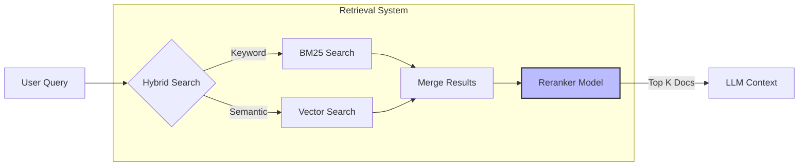

# AI Agent 개발을 위한 Production Question 가이드 (강의용 확장판)
> “에이전트를 어떻게 만드는가”가 아니라  
> “왜 대부분의 에이전트가 운영에서 실패하는가”를 설명하기 위한 실전 가이드  
>  
> 대상: AI Agent를 실제 서비스로 운영하려는 소프트웨어 엔지니어

---

## 1. 목적(Purpose) & 사용 방식(How to Use)

### 핵심 질문  
**에이전트가 잘못된 결과를 냈을 때, 누가 책임을 지며 시스템은 어떻게 회복되는가?**

### 강의 설명  
대부분의 AI Agent 튜토리얼은 “에이전트가 무엇을 할 수 있는지”에 집중합니다.  
하지만 실제 운영 환경에서 더 중요한 질문은 다음입니다.

> “이 결과가 틀렸을 때, 우리는 무엇을 할 수 있는가?”

LLM은 deterministic system이 아닙니다.  
따라서 **오답은 버그가 아니라 정상 동작 범위**에 속합니다.  
문제는 오답 그 자체가 아니라,  
- 오답을 누가 책임지는지
- 오답 이후 시스템이 어떻게 행동하는지
가 설계되어 있지 않다는 점입니다.

### 실무 사례  
- 계약서 요약 에이전트가 중요한 면책 조항을 누락
- 사용자는 이를 사실로 받아들이고 내부 보고에 사용
- 이후 법무 검토 단계에서 오류 발견

이때 흔히 발생하는 혼란:
- “AI가 그렇게 말했어요”
- “사용자가 확인 안 한 게 문제 아닌가요?”
- “이건 PoC라서…”

→ **책임 경계가 정의되지 않은 시스템은 반드시 분쟁을 만든다**

### 설계 관점에서 던져야 할 질문
- 이 에이전트의 결과는 **의사결정 보조인가, 결정 자체인가?**
- 어떤 결과는 반드시 사람의 확인을 거쳐야 하는가?
- 사용자가 에이전트의 한계를 명확히 인지하도록 UX가 설계되어 있는가?

### 핵심 교훈
- 에이전트의 “사용 가이드”는 설명서가 아니라 **책임 계약서**다
- 에이전트가 못하는 것을 명시하지 않으면, 사용자는 모든 것을 기대한다
- Purpose 설계는 기능 설계보다 먼저 와야 한다

---

## 2. LLM 모델 선택 기준

### 핵심 질문  
**이 모델이 느려지거나, 장애가 나거나, Quota에 걸리면 시스템은 어떻게 동작하는가?**

### 강의 설명  
LLM을 라이브러리처럼 생각하는 순간, 운영은 실패합니다.  
LLM은 다음과 같은 특성을 가진 **외부 시스템 의존성**입니다.

- 네트워크를 탄다
- 지역별 성능 편차가 있다
- 예고 없이 느려진다
- 요금과 쿼터가 있다

그럼에도 많은 설계가 다음 가정 위에 서 있습니다.

> “이 모델은 항상 빠르고, 항상 응답한다”

이 가정은 반드시 깨집니다.

### 실무 사례  
- 특정 리전에서 LLM 응답이 평소보다 5~10배 느려짐
- 프론트엔드는 스트리밍이 멈춘 것처럼 보임
- 사용자는 새로고침 → 동일 요청 재전송
- 백엔드에서는 동일 작업이 중복 실행 → 비용 폭증

### 설계 관점에서 던져야 할 질문
- 이 작업은 반드시 이 모델이어야 하는가?
- 응답이 늦어질 경우 UX는 어떻게 반응해야 하는가?
- 모델 장애 시 기능을 축소해서라도 제공할 수 있는가?

### 핵심 교훈
- 모델 선택은 AI 성능 문제가 아니라 **아키텍처 문제**다
- “최고 성능 모델 하나”보다 “상황별 모델 조합”이 훨씬 안정적이다
- 하이퍼파라미터 기본값은 출발점이지 정답이 아니다

---

## 3. Planning & Orchestration (Workflow)

### 핵심 질문  
**이 워크플로우는 언제, 어떤 기준으로, 어떻게 중단될 수 있는가?**

### 강의 설명  
Agent 기반 시스템은 시간이 지날수록 다음과 같이 변합니다.

- 노드가 늘어난다
- 그래프가 중첩된다
- 한 번 추가된 단계는 거의 제거되지 않는다

결과적으로 “끝까지 실행하는 것이 미덕”처럼 설계되기 쉽습니다.  
하지만 운영 관점에서 중요한 것은 **완주 여부가 아니라 가치 여부**입니다.

### 실무 사례  
- RAG → 분석 → 요약 → 재질문 → 재분석
- 중간 단계에서 이미 검색 결과가 부정확
- 그럼에도 전체 파이프라인 끝까지 실행
- 결과는 별로인데, 비용은 최댓값

### 설계 관점에서 던져야 할 질문
- 지금 이 단계가 실패했다면, 다음 단계가 의미가 있는가?
- UI 중단과 연산 중단은 구분되어 있는가?
- 비용이 큰 노드는 언제 탈출할 수 있는가?

### 핵심 교훈
- 성공 경로보다 **실패 경로가 명확한 그래프**가 더 성숙한 설계다
- Abort는 예외 처리(exception)가 아니라 정상 흐름이다
- Debugging 가능한 Orchestration이 운영 비용을 줄인다

---

## 4. Action & Tool

### 핵심 질문  
**이 작업을 LLM에게 맡김으로써 시스템은 단순해졌는가, 아니면 불투명해졌는가?**

### 강의 설명  
Tool은 LLM의 능력을 확장하지만, 동시에 **책임과 추론을 이전**합니다.  
특히 다음과 같은 경우 문제가 됩니다.

- 결정적이어야 할 로직
- 재현성이 필요한 작업
- 사후 분석이 필요한 판단

### 실무 사례  
- Git 브랜치명 생성, 커밋 메시지 작성, 배포 판단까지 LLM에 위임
- 결과는 매번 다르고, 기준을 설명할 수 없음
- 장애 발생 시 “왜 그렇게 판단했는지” 추적 불가

### 설계 관점에서 던져야 할 질문
- 이 판단은 확률적이어도 괜찮은가?
- 코드로 표현 가능한 규칙은 없는가?
- LLM이 선택해야 할 옵션 수는 최소화되어 있는가?

### 핵심 교훈
- Tool은 기능이 아니라 **책임 단위**로 설계해야 한다
- LLM이 고민해야 할 선택지가 줄어들수록 품질은 올라간다
- “LLM이 잘할 것”이라는 기대는 설계가 아니다

---

## 5. Memory

### 핵심 질문  
**이 시스템은 중단 후 재개했을 때, 같은 맥락을 유지할 수 있는가?**

### 강의 설명  
메모리는 흔히 “지능을 높이는 기능”으로 소개됩니다.  
하지만 운영 관점에서 메모리는 **복구 메커니즘**입니다.

### 실무 사례  
- 장시간 분석 중 네트워크 끊김
- 사용자가 다시 접속
- 에이전트는 일부만 기억 → 이전 판단 근거 상실
- 결과적으로 앞뒤가 맞지 않는 답변 생성

### 설계 관점에서 던져야 할 질문
- 언제 상태를 저장하는가?
- 어떤 상태는 저장하지 않아도 되는가?
- 요약은 어떤 기준으로 수행되는가?

### 핵심 교훈
- 기억한다 ≠ 복원할 수 있다
- 메모리는 UX 기능이 아니라 장애 대비 장치다
- 저장보다 중요한 것은 “언제 버릴지”다

---

## 6. Knowledge Base (RAG)

### 핵심 질문  
**이 답변이 어떤 정보에 근거했는지, 시스템은 설명할 수 있는가?**

### 강의 설명  
RAG 실패는 대부분 사용자에게 이렇게 보입니다.

> “AI가 거짓말했다”

하지만 실제 문제는:
- 검색 실패
- 잘못된 문서 선택
- 근거 관리 부재

### 실무 사례  
- 사내 규정 QA
- 답변은 그럴듯하지만 실제 문서와 다름
- 사용자가 근거를 요구하자 시스템은 침묵

### RAG Retrieval Flow Diagram


### 설계 관점에서 던져야 할 질문
- 검색 실패를 실패로 인식하고 있는가?
- 어떤 경우에는 답변을 거부해야 하는가?
- Chunk는 토큰 기준인가, 의미 기준인가?

### 핵심 교훈
- RAG의 가장 큰 리스크는 **침묵 실패**다
- “아무것도 못 찾았다”는 답변이 잘못된 답변보다 낫다
- Retrieval은 AI 문제가 아니라 정보 구조 문제다

---

## 7. Eval & Feedback

### 핵심 질문  
**작은 변경이 전체 품질을 망쳤다는 사실을 우리는 언제 알 수 있는가?**

### 강의 설명  
에이전트 시스템은 대부분 다음과 같이 퇴화합니다.

- 한 문장 수정
- 한 노드 추가
- 한 툴 변경

→ 전체 품질이 조금씩 나빠짐  
→ 아무도 눈치채지 못함  
→ 고객이 먼저 발견

### 실무 사례  
- 프롬프트 수정 후 특정 질문 유형만 품질 급락
- 내부에서는 정상처럼 보임
- 수 주 후 고객 불만으로 인지

### 설계 관점에서 던져야 할 질문
- 변경 전/후를 비교할 기준이 있는가?
- 품질 판단 주체는 누구인가?
- 자동 평가의 한계를 인지하고 있는가?

### 핵심 교훈
- Eval은 정확도 측정이 아니라 **변화 감지 시스템**이다
- 완벽한 자동 평가는 없다
- Eval 없는 Agent는 결국 신뢰를 잃는다

---

## 8. Advanced Architecture & Stack (심화 가이드)

### 아키텍처 패턴 (Architecture Pattern)
- **Single vs Multi:** 
  - 처음부터 Swarm 등 복잡한 Multi-Agent로 시작하지 마십시오. **Single Agent**로 시작하고, 복잡도가 증가하면 **Supervisor** 패턴으로 분리하는 것이 운영 및 디버깅에 유리합니다.

  ```mermaid
  graph TD
      User((User)) --> Supervisor{Supervisor Agent}
      
      subgraph "Specialized Agents"
          Supervisor -->|Delegate| Research[Research Agent]
          Supervisor -->|Delegate| Coding[Coding Agent]
          Supervisor -->|Delegate| Review[Review Agent]
      end
      
      Research -->|Result| Supervisor
      Coding -->|Result| Supervisor
      Review -->|Result| Supervisor
      
      Supervisor -->|Final Answer| User
      
      style Supervisor fill:#f9f,stroke:#333,stroke-width:2px
  ```

- **Worker & Queue:**
  - 요청이 끊겨도 작업이 수행되어야 한다면 **Celery**나 **Dramatiq** 같은 비동기 워커를 사용하십시오.
  - 설정이 간편한 **Dramatiq**를 추천합니다.
- **State Management:**
  - 데모는 In-memory로 충분하지만, 운영 환경은 **Redis(Hot Storage)** 와 **DB(Cold/Audit Storage)** 가 필수입니다.
  - LangGraph **Checkpointer** 사용 시 저장소 용량 증가에 유의해야 합니다.

### RAG & Database Strategy
- **DB Selection:** 
  - 1,000만 건 미만의 데이터는 별도의 Vector DB 없이 **PostgreSQL + pgvector**로 충분합니다.
  - 관리 포인트와 비용을 줄이는 것이 아키텍처의 핵심입니다.
- **Search Logic:**
  - 정확도가 중요하다면 **Hybrid Search (Keyword + Vector)** 에 **Rerank**를 조합하십시오.
- **Chunking:**
  - 길이 기반(Fixed Size)보다는 **의미 기반(Semantic)** 청킹이 유리합니다.
  - 표나 코드는 구조적(Structural) 청킹을 적용해야 합니다.

---

## 9. UX & Stability

### 핵심 질문
**"LLM이 멈추거나 헛소리를 할 때, 사용자는 무엇을 보는가?"**

### 실무 가이드
- **Latency & Streaming:** 스트리밍은 선택이 아닌 필수입니다.
- **Fallback Strategy:** 특정 리전이나 모델 장애 시 자동으로 다른 모델/리전으로 전환되는 로직(Model Router)을 구현하십시오.

  ```mermaid
  sequenceDiagram
      participant App
      participant Primary as Primary Model (GPT-4)
      participant Fallback as Fallback Model (GPT-3.5/Haiku)
      
      App->>Primary: Request
      alt Success
          Primary-->>App: Response
      else Timeout / Error
          App->>Fallback: Retry Request (Fallback)
          Fallback-->>App: Response (Degraded but working)
      end
  ```

- **Offline Support:** 읽기 전용 기능은 PWA로 지원하되, 오프라인 생성 기능(WebLLM 등)은 복잡도가 높으므로 신중히 결정하십시오.

---

## 10. Security

### 핵심 질문
**"프롬프트에 '보안 유지'라고 쓰면 보안이 되는가?"**

### 실무 가이드
- **Guardrails:** 프롬프트는 보안 레이어가 아닙니다. PII(개인정보) 필터링이나 비속어 차단은 LLM 앞단에서 **Middleware(Regex, NeMo Guardrails)** 로 처리해야 합니다.
- **Prompt Injection:** 사용자 입력을 그대로 프롬프트에 삽입하지 말고, 구조화된 포맷(JSON/XML)으로 감싸서 주입하십시오.

---

## Appendix. Tech Decision Matrix (Cheat Sheet)

| 영역 | 고민 항목 | 추천 전략 (Default) | 대안 / 비고 |
| :--- | :--- | :--- | :--- |
| **Architecture** | Single vs Multi | **Single Agent** | 복잡도 증가 시 **Supervisor**. Swarm은 비추천. |
| **Worker** | 비동기 처리 | **Dramatiq** | Celery는 설정 복잡, RQ는 기능 부족. |
| **RAG DB** | 저장소 선택 | **PostgreSQL + pgvector** | 1,000만 건 이상일 때 Pinecone 등 고려. |
| **Search** | 검색 전략 | **Hybrid + Rerank** | 속도가 최우선이면 Vector Only. |
| **Memory** | State 저장 | **Redis(Hot) + DB(Cold)** | 단순 데모는 In-memory. |
| **Orchestration** | 제어 방식 | **LangGraph** | Checkpointer 용량 관리 주의. |
| **Tool** | 툴 개수 | **10개 미만** | 많으면 Agent 분리 필요. |
| **Observability** | 모니터링 | **LangFuse (Self-hosted)** | 보안/비용 이슈 없다면 LangSmith. |
| **Security** | 가드레일 | **Middleware (Regex/Logic)** | 프롬프트 보안은 절대 믿지 말 것. |

---

## 최종 메시지

> AI Agent Engineering은  
> “LLM을 잘 쓰는 기술”이 아니라  
> **불완전한 시스템을 안전하게 운영하는 기술**이다.

> 이 질문들은 개발을 느리게 하지만,  
> **사고를 훨씬 늦게 오게 만든다.**
